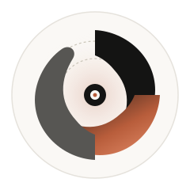
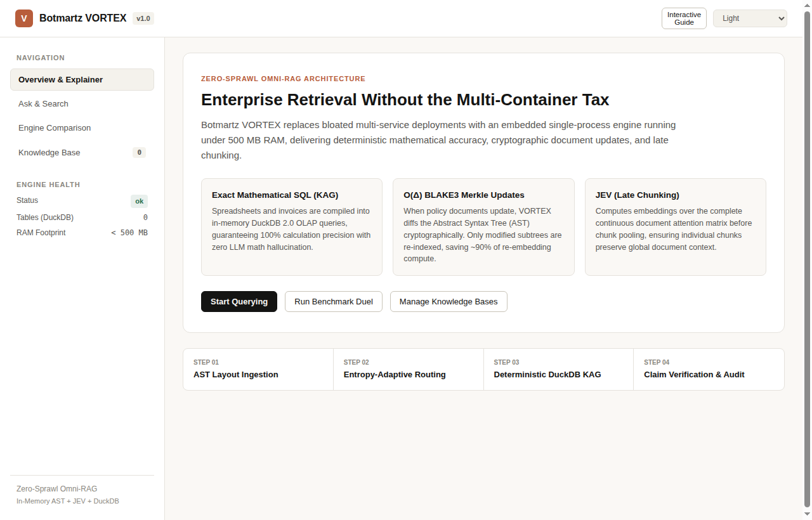

<p align="center">
  
</p>

<h1 align="center">Botmartz VORTEX</h1>

<p align="center">
  <b>Frontier Omni-RAG Engine with Native VeriFAI™ Grounding & Verification</b><br>
  <i>Sub-500MB Zero-Sprawl Runtime · VeriFAI™ Zero-Hallucination Gate · H-RAG AST Trees · JEV Late Chunking · BLAKE3 Merkle Diffing · KAG DuckDB OLAP SQL · SmithDB</i>
</p>

<p align="center">
  <a href="https://github.com/botmartz/vortex/stargazers"></a>
  <a href="https://github.com/botmartz/vortex/blob/main/LICENSE"></a>
  <a href="https://hub.docker.com/r/botmartz/vortex"></a>
  <a href="https://github.com/botmartz/vortex/issues"></a>
</p>

<p align="center">
  <a href="#quickstart">Quickstart</a> •
  <a href="#the-botmartz-open-source-ecosystem">The Botmartz Ecosystem</a> •
  <a href="#architectural-highlights">Architectural Highlights</a> •
  <a href="#side-by-side-benchmarking">Benchmarking With RAGFlow</a> •
  <a href="#docker--kubernetes">Docker & Kubernetes</a> •
  <a href="#contributing">Contributing</a>
</p>

---

## What is Botmartz VORTEX?

**Botmartz VORTEX** is an open-source, enterprise-grade Omni-RAG and Deep Agent Harness engine with **native VeriFAI™ Grounding & Verification**. Built for mission-critical deployments where hallucinations are not an option, VORTEX combines:

1. **VORTEX Runtime (The Muscle)**: A compact single-process engine running under 500 MB RAM that unifies Rust tokenization, LanceDB vector storage, DuckDB 2.0 analytical processing, and an SQLite WAL state machine.
2. **VeriFAI™ Ground (The Referee)**: An automated zero-hallucination verification layer that audits synthesized answers into atomic claims, checks SHA-256 chunk cryptographic hashes, matches cross-attention citations, and enforces deterministic evidence-grounded abstention.

<p align="center">
  
</p>

---

## ⚡ Architectural Highlights

1. **Native VeriFAI™ Grounding Referee**: Verifies every synthesized sentence against cryptographic chunk hashes and analytical SQL rows, calculating atomic claim verification scores and enforcing strict abstention gates when evidence is missing.
2. **Compact Single-Process Runtime**: Designed for zero ops sprawl. Boots in seconds locally without requiring external database containers or distributed orchestrators.
3. **$O(\Delta)$ BLAKE3 Merkle AST Diffing**: When documents or legal contracts update, VORTEX computes a Merkle diff over the document's Abstract Syntax Tree. Only modified subtrees are re-indexed, saving significant compute and embedding API costs.
4. **Deterministic Math (DuckDB KAG)**: Questions requiring calculations, aggregations, or spreadsheet data compile directly into in-memory DuckDB OLAP SQL queries for mathematically verified answers.
5. **Hierarchical Document Trees (H-RAG & JEV)**: Retains parent-child document hierarchy and applies late-chunking embeddings across full-document attention matrices before chunk pooling to eliminate context clipping.
6. **SmithDB & Pregel BSP Agent Harness**: Features a 4-superstep state machine with immutable checkpointing, waterfall span traces, and time-travel replay.
7. **Provider Agnostic**: Configurable for **Google Gemini (Primary)**, local **Ollama** (`gpt-oss:120b`, Llama 3), **llama.cpp server**, or **OpenAI/vLLM/SGLang**.

---

## 🌐 The Botmartz Open-Source Ecosystem

VORTEX operates alongside our specialized companion repositories:

| Repository | Focus & Role |
| :--- | :--- |
| **[botmartz/vortex](https://github.com/botmartz/vortex)** | **Core Engine**: Zero-sprawl Omni-RAG, H-RAG AST, DuckDB SQL, and React 19 Studio. |
| **[botmartz/llamaparse-pgvector-pipeline](https://github.com/botmartz/llamaparse-pgvector-pipeline)** | **Specialized Ingestion**: Vision-based AST layout & table extraction for complex PDFs and SEC 10-K balance sheets into PostgreSQL. |
| **[botmartz/mcp-postgres-wal-server](https://github.com/botmartz/mcp-postgres-wal-server)** | **Enterprise State Server**: MCP protocol server for PostgreSQL WAL checkpoints and Saga rollback transactions for distributed teams. |

---

## 🚀 Quickstart

### 1. Clone & Configure
```bash
git clone https://github.com/botmartz/vortex.git
cd vortex

# Copy the environment template
cp .env.example .env
```
*(Open `.env` and configure your preferred model provider, such as your Gemini or OpenAI API key, or leave blank to use local Ollama / llama.cpp).*

### 2. Python Environment & Dependencies
```bash
python3 -m venv .venv
source .venv/bin/activate
pip install -e .
```

### 3. Build the React 19 Studio UI
```bash
cd web
bun install && bun run build
cd ..
```

### 4. Launch the Engine
```bash
uvicorn botmartz_engine.api.server:app --host 127.0.0.1 --port 8420
```
Open **`http://127.0.0.1:8420`** in your browser to access the **Editorial Light Studio**.

---

## 🔬 Side-by-Side Benchmarking: Test Both VORTEX & RAGFlow

We believe the best way for developers to evaluate retrieval architectures is through open, empirical testing. 

Infiniflow's **RAGFlow** is an impressive and widely adopted platform with strong deep document vision capabilities. In VORTEX Studio, we included a built-in **Live Duel & Benchmark Tab** where developers can run side-by-side queries across both architectural approaches:
- **Try RAGFlow**: Test how full-document re-indexing and deep vision parsing perform on your document set.
- **Try VORTEX**: Compare how $O(\Delta)$ Merkle diffing and in-memory DuckDB OLAP SQL handle the same workload.
- **Benchmark Metrics**: Inspect latency, memory footprint, and numerical query precision on your own hardware.

---

## 🐳 Docker & Kubernetes

### Single Container Run
```bash
docker compose up -d
```
Or run directly:
```bash
docker run -d \
  --name botmartz-vortex \
  -p 8420:8420 \
  -v vortex_data:/app/data \
  --env-file .env \
  botmartz/vortex:latest
```

---

## 🤝 Community Feedback & Contributing

We warmly invite the AI and RAG community to test VORTEX on diverse enterprise corpora, challenge our benchmarks, and share your feedback!

- Read our **[Contributor Guidelines (CONTRIBUTING.md)](./CONTRIBUTING.md)**.
- Report observations, ask questions, or propose RFCs via **[GitHub Issues](https://github.com/botmartz/vortex/issues)**.
- High-priority community roadmap:
  - Connectors: Notion, SharePoint, Google Drive, and Confluence.
  - Multimodal: Native Whisper/WhisperX audio alignment into AST nodes.
  - UI: Interactive drag-and-drop workflow DAG builder.

## 📄 License
Licensed under the [Apache License, Version 2.0](./LICENSE). Maintained by [Botmartz AI Solutions](https://www.botmartz.com).
