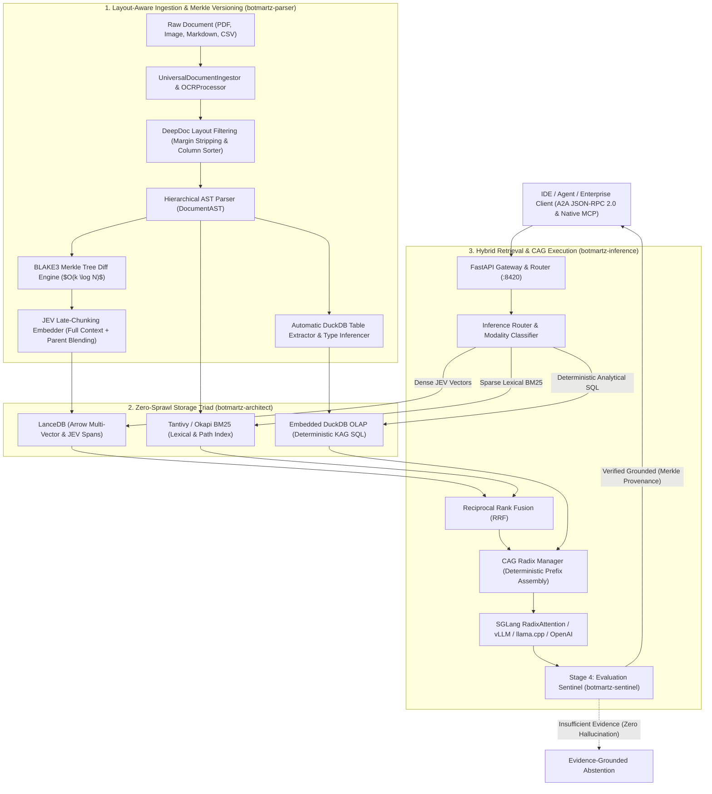

# Botmartz VORTEX (Verified Omni-RAG Tree & Execution Engine) — System Architecture MOC

> [!IMPORTANT]
> **Flagship Mission Statement**: **Botmartz VORTEX** is an enterprise-grade, zero-sprawl Rust + Python hybrid engine engineered to surpass legacy RAG platforms (such as `legacy multi-container RAG stacks`, Dify, and LlamaIndex). VORTEX consolidates **Hierarchical AST Document Trees (H-RAG)**, **Joint Embedding & Late Chunking (JEV)**, **RadixAttention KV-Cache Augmented Generation (CAG)**, **Deterministic DuckDB Knowledge-Augmented Generation (KAG)**, **BLAKE3 Merkle Versioning**, and a dual **A2A / MCP Protocol Mesh** into a single embedded process with an idle RAM footprint under 500 MB.

---

## 1. High-Level System Topology

---

## 2. Core Architectural Specifications

- **[[01-Architecture-Specs/01-H-RAG-and-Merkle-AST|01 — H-RAG Hierarchical Document Trees & BLAKE3 Merkle Versioning]]**
  - Solves flat, lossy chunking and replaces expensive full-document re-indexing with top-down $O(k \log N)$ BLAKE3 Merkle diffing on document revisions.
- **[[01-Architecture-Specs/02-JEV-Late-Chunking|02 — JEV (Joint Embedding & Late Chunking) Specification]]**
  - Preserves global cross-chunk context and resolves anaphora/coreference by computing embeddings over long transformer windows before pooling with parent residual blending ($\alpha \cdot \text{span} + (1-\alpha) \cdot \text{parent}$).
- **[[01-Architecture-Specs/03-CAG-and-KAG-Hybrid-Engine|03 — CAG (Radix KV-Cache) & KAG (DuckDB Deterministic SQL) Engine]]**
  - Eliminates retrieval latency for hot corpora via RadixAttention prefix pinning and prevents LLM arithmetic hallucinations through deterministic DuckDB SQL synthesis.
- **[[01-Architecture-Specs/04-Agent-Delegation-Graph-and-MCP|04 — Agent Delegation Graph & Native MCP Server]]**
  - Defines the 4-stage runtime delegation pipeline (`Ingestion Agent`, `Storage/Index Agent`, `Inference Router`, `Evaluation Sentinel`) and native MCP tooling.
- **[[01-Architecture-Specs/05-Botmartz-DNA-and-Traditional Multi-Container RAG-Replacement|05 — Botmartz DNA & In-House Traditional Multi-Container RAG Replacement Blueprint]]**
  - Outlines the strategic enterprise doctrine of Botmartz AI Solutions Private Limited, sovereign air-gapped deployment, and our in-house Traditional Multi-Container RAG replacement rationale.
- **[[01-Architecture-Specs/06-Docling-OCR-and-Vision-AST|06 — Docling OCR & Vision AST Layout Parser]]**
  - Details `UniversalDocumentIngestor`, dual-backend `OCRProcessor` (PyMuPDF + RapidOCR + OpenAI Vision), DeepDoc lessons (header/footer margin stripping, two-column reading order spatial sort, dehyphenation), and auto-extracted DuckDB tables.
- **[[01-Architecture-Specs/07-A2A-and-MCP-Protocol-Mesh|07 — A2A & MCP Protocol Mesh]]**
  - Explains the dual open protocols: `/.well-known/agent.json` Agent Card, `/a2a` JSON-RPC 2.0 endpoints (`tasks/send`, `tasks/get`, `agents/list`), and `/mcp` + `stdio` Model Context Protocol tools.
- **[[01-Architecture-Specs/08-Skills-and-Subagents-Catalog|08 — Skills & Subagents Catalog]]**
  - Catalogs all 15 `.agents/skills` directories, the 4 core Antigravity subagents, the Evaluation Sentinel, and the OpenAI supportive agent.

---

## 3. Technical RFCs

- **[[02-RFCs/RFC-001-Surpassing-Traditional Multi-Container RAG-Benchmark|RFC-001 — Surpassing Traditional Multi-Container RAG Architectural Benchmark]]**
  - In-depth architectural comparison against `legacy multi-container RAG stacks` (`traditional-rag-reference`) demonstrating how Botmartz VORTEX replaces 14 containers with 1 embedded process, slashes idle RAM from 8–16 GB to <500 MB, enables surgical BLAKE3 Merkle diffing, guarantees 100% deterministic tabular calculations via DuckDB, and accelerates TTFT via RadixAttention CAG.

---

## 4. Protocol Mesh & Integrations

- **Agent-to-Agent (A2A) Protocol**:
  - `GET /.well-known/agent.json` — Standardized machine-readable agent card.
  - `POST /a2a` — JSON-RPC 2.0 router (`tasks/send`, `tasks/get`, `tasks/cancel`, `agents/list`).
- **Model Context Protocol (MCP)**:
  - `POST /mcp` — Streamable HTTP gateway.
  - `python -m botmartz_engine.api.mcp_server` — Local stdio transport for IDEs.
  - Exposed Tools: `vortex_ingest_document`, `vortex_hybrid_query`, `vortex_kag_sql_query`, `vortex_inspect_ast_merkle`, `vortex_a2a_delegate`, `vortex_model_vault_status`.
- **VORTEX Studio Web Interface**:
  - `GET /` — Interactive web application for document indexing, tabular queries, live search, and CAG Radix telemetry.

---

## 5. Specialist Subagents & Skills Mesh

VORTEX coordinates capabilities defined across 15 skills in `.agents/skills`:

| Subagent / Specialist | Focus Area | Primary Skills |
| :--- | :--- | :--- |
| **`botmartz-architect`** | Systems Architecture, Rust Core & Triad Storage | `rust`, `lancedb`, `duckdb`, `mcp-server`, `python-fastapi` |
| **`botmartz-parser`** | Layout AST Parsing, OCR & JEV Late Chunking | `docling-ocr`, `jev-late-chunking`, `rust` |
| **`botmartz-inference`** | Hybrid RRF, CAG Radix Cache & DuckDB KAG SQL | `cag-radix-cache`, `duckdb`, `sglang`, `vllm`, `python-fastapi` |
| **`botmartz-sentinel`** | Evidence-Grounded Abstention & Merkle Audit | `sentinel-abstention`, `Traditional Multi-Container RAG-benchmark` |
| **`botmartz-obsidian`** | Obsidian Vault & Technical RFCs Specialist | `obsidian` |
| **`openai-support-agent`**| Cloud Reasoning, Vision OCR & NL-to-SQL Fallback | `docling-ocr`, `duckdb` |

---

## 6. Daily Execution Logs

- **[[04-Daily-Logs/2026-11-14-System-Initialization|2026-11-14 — System Initialization & D-Drive Core Scaffold]]**
  - Initial workspace scaffold, Rust crates creation, Python virtual environment, and baseline architecture specs.
- **[[04-Daily-Logs/2026-11-14-Full-VORTEX-Engine-Build-and-Test|2026-11-14 — Full VORTEX Engine Build & Verification Log]]**
  - Full end-to-end implementation of VORTEX engine, Docling OCR layout parser, DuckDB table extraction, A2A JSON-RPC 2.0, MCP gateway, Studio UI, and 100% pass verification on both `cargo test` and `pytest`.
