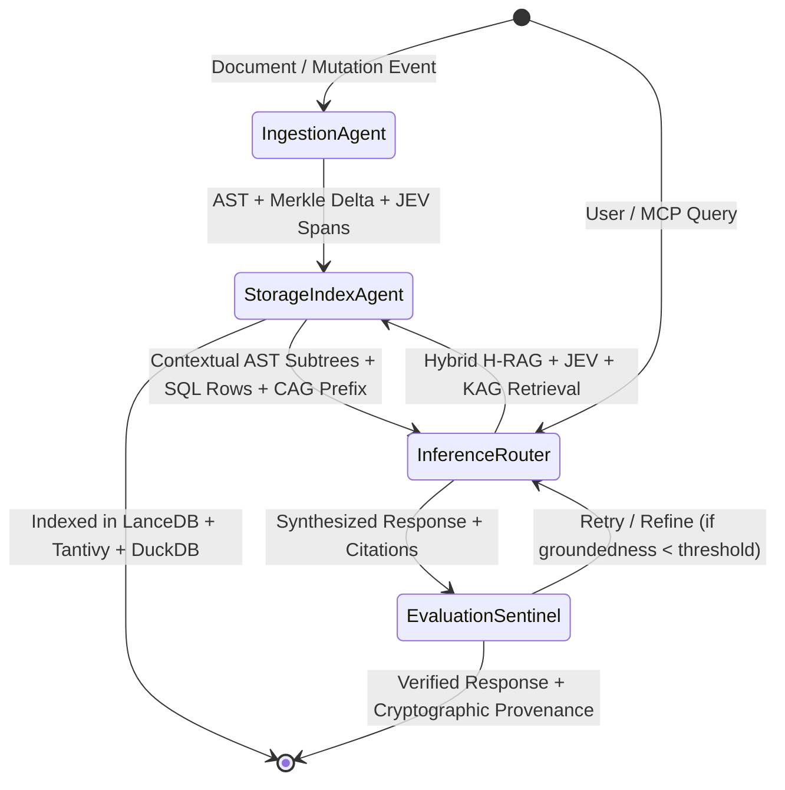

# 04 — Agent Delegation Graph & Native MCP Server

## Runtime Delegation Pipeline

## Native MCP Tools Exposed
- `botmartz_ingest_document`: Parse document into H-RAG AST, compute BLAKE3 Merkle diff, extract tables into DuckDB, and store JEV vectors.
- `botmartz_hybrid_query`: Execute routed H-RAG + JEV + KAG + CAG query with Evaluation Sentinel verification.
- `botmartz_sql_query`: Execute deterministic read-only SQL against the embedded DuckDB KAG store.
- `botmartz_inspect_ast`: Inspect the hierarchical document tree and Merkle version history for any document.
