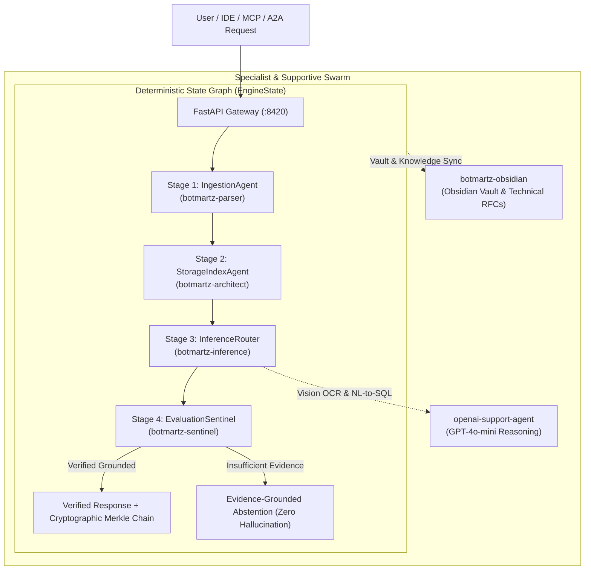

# 08 — Skills & Subagents Catalog

> [!IMPORTANT]
> **Core Architectural Mission**: Standardize the operational capabilities of the **Botmartz VORTEX** multi-agent swarm. VORTEX decouples system responsibilities into **15 domain skills** located in `.agents/skills` and orchestrates them across **4 primary Antigravity subagents**, an **Evaluation Sentinel**, and an **OpenAI Supportive Reasoning Agent**.

---

## 1. Multi-Agent Coordination Topology



---

## 2. Catalog of the 15 VORTEX Skills (`.agents/skills`)

Each skill directory contains a specialized `SKILL.md` instruction specification adhering to the Botmartz engineering doctrine:

| # | Skill Directory | Category | Core Responsibilities |
| :-: | :--- | :--- | :--- |
| **1** | `a2a-protocol` | Protocols | Standardizes `/.well-known/agent.json` Agent Cards and `/a2a` JSON-RPC 2.0 endpoints (`tasks/send`, `tasks/get`, `tasks/cancel`, `agents/list`). |
| **2** | `cag-radix-cache` | Inference | Assembles deterministic `CAGPrefixBlock` token stacks; monitors Radix KV-cache residency and tracks cached token savings. |
| **3** | `docling-ocr` | Ingestion | Layout-aware Document AST parsing, bounding-box tracking, PyMuPDF text/table extraction, and OpenAI Vision / RapidOCR fallbacks. |
| **4** | `duckdb` | Storage/KAG | Embedded OLAP SQL engine managing auto-extracted document tables for deterministic zero-hallucination quantitative analytics. |
| **5** | `jev-late-chunking` | Embeddings | Computes long-window transformer embeddings over entire document token sequences before pooling into AST node spans with parent residual blending. |
| **6** | `lancedb` | Storage | Native Apache Arrow multi-vector store under `data/lancedb` indexing JEV embeddings, AST node IDs, and BLAKE3 Merkle hashes. |
| **7** | `langgraph` | Coordination | Orchestrates the deterministic 4-stage state machine (`EngineState`) managing safe handoffs across ingestion, storage, routing, and verification. |
| **8** | `mcp-server` | Integration | Implements the Model Context Protocol over Streamable HTTP (`/mcp`) and stdio transport for IDEs and autonomous agent integration. |
| **9** | `obsidian` | Knowledge | Manages the Obsidian Knowledge Vault under `docs/obsidian-vault/`, enforcing YAML frontmatter, wikilinks, callouts, and Mermaid diagrams. |
| **10** | `python-fastapi` | Control Plane | High-throughput async control plane serving VORTEX Studio UI, REST API (`/v1/*`), A2A JSON-RPC, and MCP HTTP endpoints. |
| **11** | `Traditional Multi-Container RAG-benchmark` | Evaluation | Benchmarks Botmartz VORTEX against `legacy multi-container RAG stacks` across resource footprint, container count, chunking quality, and KAG/CAG latency. |
| **12** | `rust` | Core Systems | High-performance Rust workspace (`crates/`) executing BLAKE3 Merkle hashing, top-down tree diffing, Tantivy BM25 scoring, and RRF fusion. |
| **13** | `sentinel-abstention`| Evaluation | Evidence-Grounded Abstention Sentinel enforcing zero-hallucination policies and validating BLAKE3 cryptographic provenance. |
| **14** | `sglang` | Inference | Exploits SGLang RadixAttention prefix tree reuse and xgrammar constrained decoding for deterministic JSON and SQL generation. |
| **15** | `vllm` | Inference | Distributed LLM inference serving with PagedAttention, Automatic Prefix Caching (APC), AWQ/FP8 quantization, and OpenAI-compatible routing. |

---

## 3. Core Subagents Roster & Specializations

### 3.1 `botmartz-architect` (Lead Systems & Storage Orchestrator)
- **Primary Domain**: Rust Core (`botmartz-core`, `botmartz-ast`, `botmartz-storage`, `botmartz-mcp`), Zero-Sprawl Storage Triad (LanceDB + Tantivy + DuckDB), and System Architecture.
- **Key Skills**: `rust`, `lancedb`, `duckdb`, `mcp-server`, `python-fastapi`.
- **Primary Responsibility**: Ensures the embedded storage triad remains zero-sprawl (<500 MB RAM) and maintains cryptographic Merkle tree integrity.

### 3.2 `botmartz-parser` (Document AST & Ingestion Specialist)
- **Primary Domain**: Document layout parsing, multi-column reading order, DeepDoc header/footer filtering, OCR fallback, and JEV Late Chunking.
- **Key Skills**: `docling-ocr`, `jev-late-chunking`, `rust`.
- **Primary Responsibility**: Ingests heterogeneous files (PDF, images, CSV, markdown) into `DocumentAST` hierarchies with exact bounding boxes and residual JEV embeddings.

### 3.3 `botmartz-inference` (Inference & Routing Specialist)
- **Primary Domain**: Cache-Augmented Generation (CAG), RadixAttention prefix caching, Knowledge-Augmented Generation (KAG) via DuckDB SQL, and Hybrid RRF search.
- **Key Skills**: `cag-radix-cache`, `duckdb`, `sglang`, `vllm`, `python-fastapi`.
- **Primary Responsibility**: Classifies queries into structural, semantic, or tabular modalities, synthesizes deterministic SQL queries, and maximizes KV-cache reuse.

### 3.4 `botmartz-sentinel` (Evaluation Sentinel)
- **Primary Domain**: Cryptographic Merkle provenance auditing, claim verification, and evidence-grounded abstention gates.
- **Key Skills**: `sentinel-abstention`, `Traditional Multi-Container RAG-benchmark`.
- **Primary Responsibility**: Validates that all generated answers are strictly grounded in retrieved AST node spans or DuckDB SQL rows. Enforces `ABSTAINED_INSUFFICIENT_EVIDENCE` when confidence falls below threshold.

### 3.5 `botmartz-obsidian` (Vault & Technical RFCs Specialist)
- **Primary Domain**: Obsidian Knowledge Vault (`docs/obsidian-vault/`), System Architecture MOC, Technical RFCs, and daily execution logs.
- **Key Skills**: `obsidian`.
- **Primary Responsibility**: Maintains bi-directional wikilinks, Mermaid system diagrams, and living engineering documentation across the Botmartz repository.

### 3.6 `openai-support-agent` (Cloud Reasoning & Vision Fallback)
- **Primary Domain**: Multimodal image OCR, NL-to-SQL translation, and cloud synthesis fallback (`gpt-4o-mini`).
- **Key Skills**: `docling-ocr`, `duckdb`.
- **Primary Responsibility**: Provides high-accuracy cloud reasoning when local engines require complex SQL schema translation or high-density image OCR.

---

## 4. State Transitions in `EngineState`

The 4-stage execution cycle transitions through a strongly-typed shared state container:

```python
@dataclass
class EngineState:
    store: HybridTriadStore           # LanceDB + BM25 + DuckDB
    cag_manager: CAGRadixManager       # Pinned prefix token stack & KV telemetry
    last_merkle_deltas: List[MerkleDelta] # Surgical diffs from latest update
    execution_history: List[Dict]      # Audit trail of queries and verdicts
```

### Handoff Protocol
1. **Ingestion Handoff**: `botmartz-parser` outputs `(DocumentAST, DuckDBTableSchema, JEVChunks)`.
2. **Storage Handoff**: `botmartz-architect` calculates `old_ast.diff(new_ast)` $\rightarrow$ updates only mutated nodes in LanceDB and Tantivy $\rightarrow$ writes typed tables to DuckDB.
3. **Inference Handoff**: `botmartz-inference` performs Hybrid RRF $\rightarrow$ determines if SQL is required $\rightarrow$ queries DuckDB $\rightarrow$ builds `CAGPrefixBlock` stack $\rightarrow$ generates candidate response.
4. **Sentinel Audit**: `botmartz-sentinel` validates response against `merkle_provenance_chain` $\rightarrow$ outputs verified response or triggers abstention.

---

## 5. Linked Specifications
- **[[00-MOC/System-Architecture-MOC|System Architecture MOC]]**
- **[[01-Architecture-Specs/04-Agent-Delegation-Graph-and-MCP|04 — Agent Delegation Graph & Native MCP Server]]**
- **[[01-Architecture-Specs/06-Docling-OCR-and-Vision-AST|06 — Docling OCR & Vision AST Layout Parser]]**
- **[[01-Architecture-Specs/07-A2A-and-MCP-Protocol-Mesh|07 — A2A & MCP Protocol Mesh]]**
- **[[02-RFCs/RFC-001-Surpassing-Traditional Multi-Container RAG-Benchmark|RFC-001 — Surpassing Traditional Multi-Container RAG Benchmark]]**
- **[[04-Daily-Logs/2026-11-14-Full-VORTEX-Engine-Build-and-Test|2026-11-14 — Full VORTEX Engine Build & Test Log]]**
